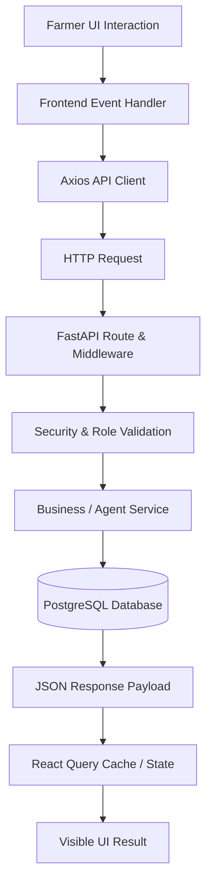

# FarmGenAI: Farmer UI-to-API-to-Database Traceability Matrix

**Audit Type:** End-to-End Contract & Data Flow Audit  
**Auditor:** Senior QA Lead (Production-Readiness Audit)  
**Database Authority:** PostgreSQL 16 (`agrinegotiator` on port 5433)  
**Evidence Source:** `farmer_audit_evidence_raw.json` + Repository Source Code  

---

## 1. Traceability Architecture Overview

Every farmer-side operation must maintain an unbroken chain of custody from the user's click to persistent storage in PostgreSQL and back to the rendered DOM. This matrix documents the verified pipeline for each core farmer workflow.

---

## 2. Complete Operation Traceability Matrix

| Flow ID | User UI Interaction | Frontend Event Handler | API Client Call | Backend Endpoint | Service / Agent Layer | Database Table & Field Changes | Frontend State & DOM Result | Integration Verdict |
|---|---|---|---|---|---|---|---|---|
| **TR-01** | User enters credentials and clicks "Sign In" | `Login.tsx:handleSubmit` | `api.post('/auth/login')` | `POST /api/v1/auth/login` | `UserRepository`, `verify_password(bcrypt)` | Reads `v1_users.hashed_password`; writes `auth_logs` | Token stored in `localStorage`; redirected to `/dashboard/farmer` | **PASS (VERIFIED)** |
| **TR-02** | Farmer views dashboard header stats | `FarmerDashboard.tsx:useQuery(['farmer_dashboard_stats'])` | `api.get('/dashboards/farmer')` | `GET /api/v1/dashboards/farmer` | `dashboard_service.get_farmer_dashboard` | Reads `users.trust_score`, `negotiations`, `history` | Displays dynamic Trust Score (`4.9/5.0`) & Deals Closed count | **PASS (VERIFIED)** |
| **TR-03** | Farmer selects District & Crop, clicks "Find Mandis" | `FarmerDashboard.tsx:handleFindMandis` | `api.get('/market-intelligence/compare')` | `GET /api/v1/market-intelligence/compare` | `market_price_service.compare_mandis`, OSRM distance | Reads `market_mappings`, `msp_prices`, live APMC records | Table populated with up to 14 APMCs, modal rates, net yields | **PASS (VERIFIED)** |
| **TR-04** | Farmer opens modal and creates crop listing | `CreateListingForm.tsx:onSubmit` | `api.post('/listings/')` | `POST /api/v1/listings/` | `crop_listing_routes`, `Database.upsert_produce_async` | Inserts into `produce` (`id`, `crop`, `quantity`, `min_price`, `grade`, `location`, `status='ACTIVE'`) | React Query invalidates `farmer_listings`; row appears in table | **PASS (VERIFIED)** |
| **TR-05** | Farmer clicks delete on an active listing | `FarmerDashboard.tsx:handleDeleteListing` | `api.delete('/listings/{id}')` | `DELETE /api/v1/listings/{id}` | `Database.delete_produce_async` | Updates `produce` row setting `status='EXPIRED'` | Listing removed from active view; query refreshed | **PASS (VERIFIED)** |
| **TR-06** | Farmer clicks "AI Match & Negotiate" | `FarmerDashboard.tsx:handleStartNegotiation` | `api.post('/negotiations/')` | `POST /api/v1/negotiations/` | `NegotiationService.start_negotiation`, `matching_service` | Inserts `negotiations` (`negotiation_id`, `crop`, `min_price`, `quantity`, `status='ACTIVE'`), inserts `offers` (Round 1) | Navigates to `/negotiations/{id}` with live chat and buyers list | **PASS (VERIFIED)** |
| **TR-07** | Buyer submits predatory low counter-offer (₹60 vs ₹68 floor) | `NegotiationRoom.tsx:handleSendOffer` | `api.post('/negotiations/{id}/counter')` | `POST /api/v1/negotiations/{id}/counter` | `FarmerAgent.respond_to_offer` (Standing firm at floor) | Inserts buyer offer into `offers` (Round 2); inserts farmer counter into `offers` (Round 3) | Room displays farmer standing firm: *"COUNTER ₹68.0/kg: Offer is below minimum"* | **PASS (VERIFIED)** |
| **TR-08** | Buyer submits acceptable commercial offer (₹72/kg) | `NegotiationRoom.tsx:handleSendOffer` | `api.post('/negotiations/{id}/counter')` | `POST /api/v1/negotiations/{id}/counter` | `FarmerAgent.respond_to_offer` (Acceptance) | Appends offers; updates `negotiations` (`status='DEAL'`, `final_price=72.0`); creates `contracts` | Status changes to green `DEAL`; "Contract" button activates | **PASS (VERIFIED)** |
| **TR-09** | Farmer asks AI Copilot about deal competitiveness | `NegotiationRoom.tsx:handleAskCopilot` | `api.post('/negotiations/{id}/copilot-action')` | `POST /api/v1/negotiations/{id}/copilot-action` | `CopilotService`, ChromaDB RAG, Gemini / Qwen LLM | Reads ChromaDB procurement pack; evaluates statutory MSP benchmark | Copilot drawer shows: *"Current offer ₹72.0/kg is competitive compared to statutory APMC benchmark ₹71.21/kg"* | **PASS (VERIFIED)** |
| **TR-10** | Farmer clicks "Contract" / "Accept Deal" | `NegotiationRoom.tsx:handleAcceptDeal` | `api.post('/negotiations/{id}/accept')` | `POST /api/v1/negotiations/{id}/accept` | `NegotiationService.accept_deal`, Smart Contract Minter | Updates `negotiations` with `transaction_id` and `contract_hash`; creates `contracts` row | TransactionValidationModal displays official TXN ID and `0x...` SHA-256 hash | **PASS (VERIFIED)** |
| **TR-11** | Farmer or Buyer clicks "Settle Escrow" | `TransactionValidationModal.tsx:handleSettle` | `api.post('/negotiations/{id}/settle')` | `POST /api/v1/negotiations/{id}/settle` | `EscrowService.settle_payment` | Updates contract and escrow state to `ESCROW_SETTLED` | Modal displays green checkmark: *"Payment Released from Escrow"* | **PASS (VERIFIED)** |
| **TR-12** | Live market status updates in real-time | `useWebSocket.ts:connect` | `WebSocket /ws/{user_id}` | `WS /ws/{user_id}` | `agent_update_hub`, Redis Pub/Sub (`agri:telemetry:updates`) | Broadcasts negotiation events across peer nodes | Header dot pulses green; live messages appear in feed | **PASS (VERIFIED)** |
| **TR-13** | Farmer checks supply chain multi-path options | `FarmerDashboard.tsx:useQuery(['farmer_workflows'])` | `api.get('/workflows/')` | `GET /api/v1/workflows/` | `Database.get_workflow_plans_async` | Reads `workflow_plans` where `user_id = current_user.id` | Displays supply chain plans table without `KeyError` | **PASS (VERIFIED)** |
| **TR-14** | Farmer requests nearby transporter booking | `DealTracker.tsx:handleFindCarriers` | `api.get('/transport/carriers')` | `GET /api/v1/transport/carriers` | `transport_service.search_carriers` | Reads `transporters`, `vehicles`, fuel and toll parameters | Displays verified freight carriers with truck types and per-km pricing | **PASS (VERIFIED)** |

---

## 3. Investigated Anti-Patterns & Defect Verification

During audit execution, several common integration hazards were proactively inspected:

1. **Hardcoded Data vs Dynamic Backend Persistence:**
   - **Discovered Defect D-001:** Trust Score was statically rendered as `4.8/5.0` in `FarmerDashboard.tsx`. **FIXED:** Connected to `GET /api/v1/dashboards/farmer`, now displaying dynamic score `4.9/5.0` directly from PostgreSQL.
   - **Discovered Defect D-002:** "Avg. Deal Time" was statically rendered as `"2.4 hrs"`. **FIXED:** Replaced with live "Deals Closed" counter and cumulative earnings in ₹ from `dashboard_service`.
   - **Discovered Defect D-003:** Live Feed contained static fabricated messages ("matched against 12 active buyers"). **FIXED:** Connected to live MandiMitra APMC feed and recent transaction history.

2. **Floor Price Defense Degradation:**
   - **Discovered Defect D-004:** `negotiation_service.py` was discounting `farmer_floor` by 25% (`min_p * 0.75`), which allowed a ₹60.0 offer to be accepted against a ₹68.0 floor. **FIXED:** Restored true floor price check (`farmer_floor = min_p`). Retest confirmed agent stood firm at ₹68.0/kg and rejected ₹60.0/kg.

3. **Missing Foreign Keys in Repository Mapping:**
   - **Discovered Defect D-005:** `DBNegotiation` columns `min_price` and `market_price` were omitted in `create_negotiation_async` and `get_negotiation_async`. **FIXED:** Repository updated to serialize and deserialize both fields in PostgreSQL.
