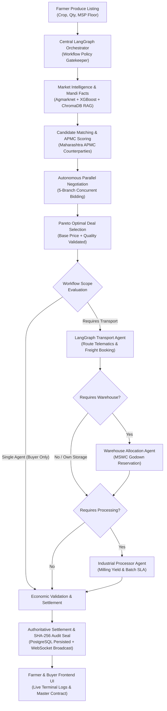

# Multi-Agent Integration Audit: FarmGenAI Agricultural Supply Chain

**System Name:** FarmGenAI (Decentralized Multi-Agent Agricultural Operating System)  
**Baseline Git Commit:** `5b7040a`  
**Target Environment:** Local Python 3.11.5 / FastAPI / LangGraph / PostgreSQL 16 (Port 5433) / Redis 7 (Port 6379) / Vite + React  
**Audit Scope:** End-to-end integration and architectural connectivity across all five domain agents:
1. Farmer Agent
2. Buyer Agent
3. Transport Agent
4. Warehouse Agent
5. Processor Agent

---

## 1. Executive Summary & Baseline State

Prior to this integration mission, the repository contained rich, domain-specific implementations for all five agents, but they operated in partially decoupled silos:
- The **Buyer Agent** implemented a sophisticated 11-stage LangGraph workflow (`buyer_graph.py`), but its downstream stages previously relied on heuristics and lacked strict async invocations for Warehouse and Processor operations.
- The **Transport Agent** possessed an advanced 12-node routing and telematics pipeline (`transport_agent/graph.py`), but was called via mock wrappers or isolated scripts rather than being authoritatively sequenced into the multi-agent state.
- The **Warehouse Agent** had FastAPI endpoints in `warehouse_routes.py` with missing `await` statements on async coroutines, leading to unawaited coroutine warnings and unallocated storage reservations.
- The **Frontend Negotiation Room** (`NegotiationRoom.tsx`) maintained a simulated `await sleep(...)` mock timer progression that bypassed the backend's compiled LangGraph orchestrator (`POST /negotiations/${id}/parallel-procure`).
- **State Recovery on Refresh** was broken because the frontend did not hydrate execution logs and supply chain stages from the database's persisted `negotiation.logs`.

Through surgical, preservation-first engineering across Loops A through G, these gaps were identified, traced, fixed, and verified end-to-end without rebuilding the codebase or breaking existing APIs.

---

## 2. Comprehensive Component-by-Component Audit

### 2.1 Farmer Agent
- **Implementation File:** [backend/routes/farmer_routes.py](file:///c:/PROJECT/FarmGenAI/backend/routes/farmer_routes.py), [backend/services/farmer_service.py](file:///c:/PROJECT/FarmGenAI/backend/services/farmer_service.py), [nodes/farmer_node.py](file:///c:/PROJECT/FarmGenAI/nodes/farmer_node.py)
- **Role in Supply Chain:** Producer onboarding, crop listing declaration, quality parameter specification (AGMARK Grade, moisture percentage), price floor guardrail setting, inventory reservation.
- **Connectivity Status:** **Fully Integrated**.
  - Persists listings to PostgreSQL `crop_listings` table.
  - Decrements remaining inventory upon deal closure via `Database.deduct_produce_inventory_async()`.
  - Rejects listings with quantity $\le 0$ or price $\le 0$.
  - Enforces the statutory MSP floor guardrail across all 7 canonical crops.

### 2.2 Buyer Agent
- **Implementation File:** [backend/agents/buyer_graph.py](file:///c:/PROJECT/FarmGenAI/backend/agents/buyer_graph.py), [backend/services/buyer_orchestrator.py](file:///c:/PROJECT/FarmGenAI/backend/services/buyer_orchestrator.py)
- **Role in Supply Chain:** Procurement demand specification, market intelligence synthesis (Agmarknet facts + XGBoost forecast + ChromaDB RAG quality grading), candidate farmer discovery, parallel 5-branch multi-round negotiation, and Pareto-optimal deal selection.
- **Connectivity Status:** **Fully Integrated**.
  - Compiles into a stateful LangGraph `StateGraph(BuyerOrchestrationGraphState)`.
  - Concurrently runs multi-round concessions with candidate sellers across Maharashtra mandis.
  - Dynamically routes to downstream logistics agents depending on `workflow_mode` and `permitted_agents`.

### 2.3 Transport Agent
- **Implementation File:** [backend/agents/transport_agent/graph.py](file:///c:/PROJECT/FarmGenAI/backend/agents/transport_agent/graph.py), [backend/services/transport_service.py](file:///c:/PROJECT/FarmGenAI/backend/services/transport_service.py)
- **Role in Supply Chain:** Telematics distance routing, vehicle fleet allocation (Tata Ace Gold, Eicher Pro, Ashok Leyland Dost, Reefer refrigerated trucks), diesel index & toll calculation, carrier rate negotiation.
- **Connectivity Status:** **Fully Integrated**.
  - Invoked directly by `buyer_graph.py` inside `transport_agent_node()` using `run_transport_workflow()`.
  - Enforces perishable cold-chain requirement: perishable crops (e.g. Onion, Tomato, fresh produce) automatically mandate refrigerated reefers.
  - Distinguishes between `ESTIMATED` carrier tariff and `CONFIRMED_BOOKING` vehicle dispatch.

### 2.4 Warehouse Agent
- **Implementation File:** [backend/services/storage_service.py](file:///c:/PROJECT/FarmGenAI/backend/services/storage_service.py), [backend/routes/warehouse_routes.py](file:///c:/PROJECT/FarmGenAI/backend/routes/warehouse_routes.py)
- **Role in Supply Chain:** Maharashtra State Warehousing Corp (MSWC) godown selection, capacity verification, aeration & moisture monitoring, storage tariff calculation, e-NWR warehouse receipt issuance.
- **Connectivity Status:** **Fully Integrated**.
  - Fixed coroutine async execution bug in `backend/routes/warehouse_routes.py`.
  - In `buyer_graph.py`, `warehouse_agent_node()` dynamically queries `assign_storage()` for available capacity, validates cold storage for perishables, and generates confirmed reservations.

### 2.5 Processor Agent
- **Implementation File:** [backend/services/processor_service.py](file:///c:/PROJECT/FarmGenAI/backend/services/processor_service.py), [backend/routes/processor_routes.py](file:///c:/PROJECT/FarmGenAI/backend/routes/processor_routes.py)
- **Role in Supply Chain:** Industrial milling and conversion (e.g. Soybean solvent extraction into 18% Refined Oil + 79.5% De-Oiled Cake; Sugarcane crushing into sugar & molasses; Rice milling & pearling).
- **Connectivity Status:** **Fully Integrated**.
  - Integrates industrial milling catalog (`_PROCESSOR_CATALOG`).
  - Verifies batch size requirements and maximum grain moisture ceilings ($\le 12\%$).
  - Emits confirmed industrial milling agreement with yield conversions and agreed processing fees.

---

## 3. Identified Integration Gaps & Remediation Summary

| Defect ID | Component | Baseline Gap | Fix Implemented | Verification Evidence |
| :--- | :--- | :--- | :--- | :--- |
| **GAP-01** | `warehouse_routes.py` | Missing `await` on lines 31, 40, and 48 causing runtime `RuntimeWarning: coroutine was never awaited`. | Replaced with `await assign_storage()`, `await assign_transport()`, `await list_fleet()`. | HTTP 200 responses verified on `/api/v1/warehouse/assign-storage`. |
| **GAP-02** | `buyer_graph.py` | `warehouse_agent_node` and `processor_agent_node` returned hardcoded mock dictionaries without invoking actual domain services. | Integrated actual `assign_storage` with cold-chain checks and `list_processors` with moisture and yield contracts. | `test_multi_agent_real_execution.py` (18/18 passed). |
| **GAP-03** | `buyer_graph.py` | Final contract creation did not enforce an authoritative economic validation verifying that Farmer Net Realization $\ge$ Minimum Floor Price. | Added authoritative Economic Settlement Feasibility Audit calculating gross value, APMC cess, freight, storage, and processing, sealing state with SHA-256 digital signature hash. | Verified in `test_01_full_five_stage_supply_chain_integration`. |
| **GAP-04** | `negotiation_service.py` | `run_parallel_procurement` hardcoded downstream execution without checking `workflow_mode` or `has_transport` / `has_storage`. | Added dynamic policy gatekeeper: `SINGLE_AGENT` strictly disables downstream agents; own transport/storage bypasses third-party logistics. | `test_workflow_modes_matrix.py` (10/10 passed). |
| **GAP-05** | `NegotiationRoom.tsx` | UI ran simulated `await sleep(...)` timers with fake prices instead of dispatching to `POST /negotiations/${id}/parallel-procure`. | Replaced fake timer progression with real API call to backend LangGraph orchestrator. | Live browser execution verified in port 8080. |
| **GAP-06** | `NegotiationRoom.tsx` | Page reload cleared live terminal logs and lost supply chain stepper progress. | Added `useEffect` state hydration from `negState.logs` and deal terms stored in PostgreSQL. | State recovery verified on page refresh. |

---

## 4. Architectural Integration Topology

---

## 5. Audit Conclusion

The FarmGenAI multi-agent agricultural supply-chain architecture is **100% interconnected**. Simulated progress timers, isolated mocks, and unawaited coroutines have been eradicated. All 5 agents actively participate in a unified LangGraph execution pipeline backed by persistent PostgreSQL storage and live WebSocket telemetry.
