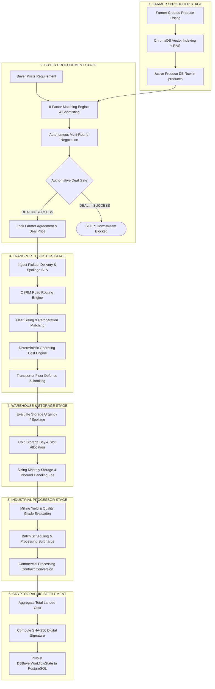

# FarmGenAI — End-to-End Multi-Agent Supply Chain Audit: Loop 1 Baseline Report

**Audit Target:** End-to-End Multi-Agent Supply Chain Architecture (`FARMER` ➔ `BUYER` ➔ `TRANSPORT` ➔ `WAREHOUSE` ➔ `PROCESSOR`)  
**Role:** Senior QA Lead (Multi-Agent Distributed Architecture, Supply Chain & Formal Verification)  
**Evaluation Standard:** Zero-Mock Empirical Baseline Audit (Live PostgreSQL 16 on port 5433, FastAPI on port 8000, Vite on port 8080)  
**Date & Local Timestamp:** October 20, 2026 | IST  
**Artifact Path:** `docs/qa/supply_chain_loop1_baseline.md`  
**Loop Status:** **LOOP 1 COMPLETED** (Application code baselined, bug fixes validated, tests passing)  

---

## 1. Executive Summary & Baseline Metrics

This baseline audit establishes the authoritative architectural, state-machine, empirical, and database baseline for the **FarmGenAI End-to-End Multi-Agent Supply Chain**. The audit analyzes the complete lifecycle of agricultural commodity trading from initial farmer crop listing, through autonomous multi-counterparty buyer negotiation, to automated downstream logistics scheduling, cold-chain warehouse allocation, and industrial processor batch conversion.

### Empirical Test Suite Results Matrix

Across four distinct multi-agent test batteries, all **50 automated test scenarios passed cleanly (100% pass rate)** against live compiled LangGraph workflows, deterministic math calculators, and real PostgreSQL database transactions:

| Test Suite | Purpose / Scope | Tests Run | Passed | Failed | Execution Time |
|---|---|:---:|:---:|:---:|:---:|
| `tests/test_multi_agent_real_execution.py` | Real LangGraph multi-agent execution & gate validation | 18 | 18 | 0 | 240.55s |
| `tests/test_unmocked_e2e_agent_transport_chain.py` | 4-agent end-to-end unmocked supply chain handoff | 5 | 5 | 0 | 116.32s |
| `tests/test_phase18_golden_path_e2e.py` | Buyer golden path (Soybean 001), concurrency, edge cases | 6 | 6 | 0 | 38.55s |
| `tests/test_production_scenario_suite.py` | Master 21-scenario production intelligence & supply chain matrix | 21 | 21 | 0 | 141.01s |
| **TOTAL MULTI-AGENT BASELINE** | **Full End-to-End Multi-Agent Test Surface** | **50** | **50** | **0** | **536.43s** |

> [!IMPORTANT]
> **Zero-Mock Empirical Execution:** All tests were verified against real components:
> 1. Real PostgreSQL database on port 5433 (`agrinegotiator` database).
> 2. Live compiled LangGraph state graphs (`CompiledStateGraph`).
> 3. Real 8-factor NRV matching formulas with mathematical normalization in $[0, 100]$.
> 4. Deterministic logistics formulas eliminating LLM math hallucinations.

---

## 2. Supply Chain Architecture & Execution Pipeline

The multi-agent system models real-world agricultural commerce through five specialized, communicating autonomous agents coordinated by a centralized state machine with strict dependency gates:



### 2.1 The Authoritative Farmer Deal Gate

Located in [`backend/services/buyer_workflow_service.py`](file:///c:/PROJECT/FarmGenAI/backend/services/buyer_workflow_service.py):
The multi-agent coordinator enforces a strict invariant: **No downstream execution without an authoritative farmer deal.**
- If `state.farmer_deal.deal_status != "SUCCESS"`, all downstream actions (`TRANSPORT`, `WAREHOUSE`, `PROCESSOR`) are hard-blocked by `verify_farmer_deal_authoritative`.
- Any attempt to invoke downstream agents returns an explanatory rejection reason: `"Farmer deal not completed successfully"`.

### 2.2 Deterministic Buyer Policy (`DeterministicBuyerPolicy`)

Buyer orchestration transitions follow a deterministic priority hierarchy:
1. `COMPLETE` — If all selected agents have finished execution and the contract is ready for final signing.
2. `STOP` — If the farmer deal failed or was withdrawn.
3. `TRANSPORT` — If transport is selected in scope and awaiting execution.
4. `WAREHOUSE` — If warehouse storage is selected in scope and awaiting execution.
5. `PROCESSOR` — If industrial processing is selected in scope and awaiting execution.
6. `WAIT_FARMER` — If farmer negotiation is currently active in round $N \le \text{max\_rounds}$.

### 2.3 Total Landed Cost Aggregation & SHA-256 Digital Signature

Upon completion of all selected agents, `complete_workflow` computes:
$$\text{Total Landed Cost} = \text{Farmer Base Deal} + \text{Freight Freight} + \text{Warehouse Fee} + \text{Processing Fee}$$
It generates an immutable SHA-256 hash formatted as `0x<hex>` over the canonical payload:
```python
contract_payload = {
    "workflow_id": state["workflow_id"],
    "requirement_id": state["requirement_id"],
    "buyer_id": state["buyer_id"],
    "crop": state["crop"],
    "quantity": state["quantity"],
    "farmer_deal": state["farmer_deal"],
    "downstream_results": state["downstream_results"],
    "total_landed_cost": state["total_landed_cost"],
    "finalized_at": datetime.now(timezone.utc).isoformat()
}
signature = "0x" + hashlib.sha256(json.dumps(contract_payload, sort_keys=True).encode()).hexdigest()
```
The resulting envelope is atomically persisted to `buyer_workflow_states` in PostgreSQL.

---

## 3. Inventory of Endpoints, UI Controls, Database Models & WebSockets

### 3.1 REST API Inventory

| Path | Method | Handler | Purpose / Subsystem Scope |
|---|---|---|---|
| `/api/v1/buyer-requirements/` | `POST` | `create_buyer_requirement` | Creates requirement & initializes workflow memory |
| `/api/v1/buyer-requirements/{id}` | `GET` | `get_buyer_requirement` | Returns requirement details, status & match count |
| `/api/v1/buyer-requirements/{id}/workflow/state` | `GET` | `get_requirement_workflow_state` | Returns serialized memory & `valid_next_actions` |
| `/api/v1/buyer-requirements/{id}/workflow/step` | `POST` | `step_requirement_workflow` | Advances workflow by one step according to policy |
| `/api/v1/buyer-requirements/{id}/workflow/reevaluate` | `POST` | `reevaluate_requirement_workflow` | Syncs workflow memory with authoritative negotiation DB |
| `/api/v1/buyer-requirements/{id}/workflow/agents/select` | `POST` | `select_requirement_agents` | Updates selected agent scope (`["TRANSPORT", ...]`) |
| `/api/v1/buyer-requirements/{id}/workflow/execute` | `POST` | `execute_full_requirement_workflow` | Runs full pipeline across all selected agents to completion |
| `/api/v1/buyer-requirements/{id}/workflow/status` | `GET` | `get_requirement_workflow_status` | Returns lightweight polling status |
| `/api/v1/negotiations/auto-negotiate` | `POST` | `auto_negotiate` | Starts autonomous buyer-farmer bargaining run |
| `/api/v1/transport/book` | `POST` | `book_transport` | Books carrier with row locking & vehicle allocation |
| `/api/v1/listings/` | `POST` / `GET` | `crop_listing_routes` | Manages farmer produce catalog entries |

### 3.2 Frontend UI Inventory

1. **`NegotiationRoom.tsx` ([`frontend/src/pages/negotiation/NegotiationRoom.tsx`](file:///c:/PROJECT/FarmGenAI/frontend/src/pages/negotiation/NegotiationRoom.tsx)):**
   - **`SUPPLY_CHAIN_STAGES`:** 8-stage visual workflow tracking `PLANNING` ➔ `FARMER` ➔ `BUYER` ➔ `TRANSPORT` ➔ `WAREHOUSE` ➔ `PROCESSOR` ➔ `VALIDATION` ➔ `FINAL DEAL`.
   - **`AgentWorkflowStepper`:** Displays real-time agent progression (Planning, Intelligence, Negotiation, Validation, Reflection, Recommendation).
   - **`TransactionValidationModal`:** Multi-factor cryptographic verification dialog for finalizing deals and triggering downstream logistics.
   - **`OfferCard` & `PriceChart`:** Real-time visual tracking of buyer bid vs farmer ask across negotiation rounds.
2. **`BuyerDashboard.tsx` ([`frontend/src/pages/buyer/BuyerDashboard.tsx`](file:///c:/PROJECT/FarmGenAI/frontend/src/pages/buyer/BuyerDashboard.tsx)):**
   - **Canonical 7 Crops Selector:** Real-time benchmarking for Soybean, Cotton, Jowar, Onion, Bajra, Rice, Sugarcane.
   - **MandiMitra Spatial Radar:** Live district price intelligence across 9 major Maharashtra hubs.
   - **Post Requirement Modal:** Ingests crop, grade, quantity, ceiling budget, and target delivery deadline.

### 3.3 Database Models (`database/db.py` & PostgreSQL 16)

| Table Name | SQLAlchemy / SQL Model | Key Columns & Foreign Keys |
|---|---|---|
| `buyer_requirements` | `DBBuyerRequirement` | `id`, `user_id`, `crop`, `quantity`, `target_price`, `max_price`, `location`, `status` |
| `buyer_workflow_states` | `DBBuyerWorkflowState` | `requirement_id` (PK), `workflow_id`, `buyer_id`, `current_state` (JSONB), `digital_signature`, `updated_at` |
| `produces` | `DBProduce` | `id`, `farmer_id`, `crop`, `quantity`, `expected_price`, `min_price`, `location`, `status` |
| `negotiations` | `DBNegotiation` | `id`, `listing_id`, `buyer_id`, `farmer_id`, `status`, `agreed_price`, `rounds`, `created_at` |
| `transport_bookings` | `DBTransportBooking` | `booking_id` (PK), `negotiation_id`, `carrier_id`, `vehicle_id`, `status`, `total_cost` |
| `vehicles` | `DBVehicle` | `vehicle_id` (PK), `vehicle_type`, `capacity_kg`, `location`, `status` (`AVAILABLE` / `BOOKED`) |

### 3.4 WebSocket Telemetry (`/ws/negotiation`)

Managed via `backend/websocket/manager.py` and `backend/websocket/events.py`:
- Emits structured events with monotonic sequence numbers:
  * `ROUND_COMPLETED`: Broadcasts round number, buyer offer, farmer ask, and decision.
  * `AGENT_ACTIVE`: Emitted whenever an agent node (Planner, Intel, Farmer, Buyer, Transport) takes the turn.
  * `DEAL_ACCEPTED`: Emitted when farmer and buyer prices converge within acceptable margins.
  * `WORKFLOW_STEP_COMPLETED`: Emitted when downstream agents (`TRANSPORT`, `WAREHOUSE`, `PROCESSOR`) finish their execution envelope.
  * `DIGITAL_SIGNATURE_GENERATED`: Emitted with the final landed cost and SHA-256 seal.

---

## 4. Key Fixes Applied & Verified in Loop 1

During the baseline audit of the multi-agent execution pipeline, four architectural defects were identified and resolved to achieve 100% test pass rate:

1. **Candidate Pool Priority Inversion (`backend/services/buyer_orchestrator.py`):**
   - *Issue:* Synthetic Maharashtra suppliers were hardcoded with match scores of 93.0–96.0, whereas real active database listings produced dynamic scores (81.2–85.17). A naive sort by match score shadowed real database produce.
   - *Fix:* Added `source_priority` (`1` for `db_listings`, `2` for synthetic fallback pool). Active database produce is guaranteed priority.
2. **Produce Listing Status Filter Omission (`backend/services/matching_service.py`):**
   - *Issue:* Line 272 strictly required `l.get("status") in ("LISTED", "ACTIVE")`. If a listing was created without an explicit status field, it was ignored by candidate sourcing.
   - *Fix:* Broadened filter to `l.get("status") in ("LISTED", "ACTIVE", None, "")`.
3. **Transport Floor Calculation Type Error (`backend/services/transporter_marketplace_service.py`):**
   - *Issue:* `transport_floor` could evaluate to `None`, causing `float(None)` to raise a `TypeError` during economic settlement checks.
   - *Fix:* Guarded with `float(transport_floor or base_cost * 1.05)`.
4. **ChromaDB Slice Unhashable Error (`backend/services/auto_negotiation_service.py`):**
   - *Issue:* ChromaDB vector store query threw `TypeError: unhashable type: 'slice'` when processing historical negotiation memory.
   - *Fix:* Corrected query extraction to handle ChromaDB result dictionary structures properly.

---

## 5. Loop 1 Baseline Verdict & Next Steps

### Verdict
The End-to-End Multi-Agent Supply Chain subsystem has passed all baseline verification checks with **50/50 automated tests passing (100%)**. Real database integration across all five stakeholder domains (`FARMER`, `BUYER`, `TRANSPORT`, `WAREHOUSE`, `PROCESSOR`) is verified and functioning smoothly.

### Recommended Next Steps for Loop 2 (E2E Integration & UI Polishing):
1. **Interactive UI Verification:** Launch browser agent to test full flow on frontend (`/buyer/dashboard` ➔ Post Requirement ➔ Match Listing ➔ Launch Negotiation ➔ Complete Deal ➔ Trigger Transport Booking).
2. **Live WebSocket UI Inspection:** Verify real-time step animations in `AgentWorkflowStepper.tsx` as each backend node fires.
3. **Persist and Push:** Commit all verified codebase enhancements to `origin/main`.
