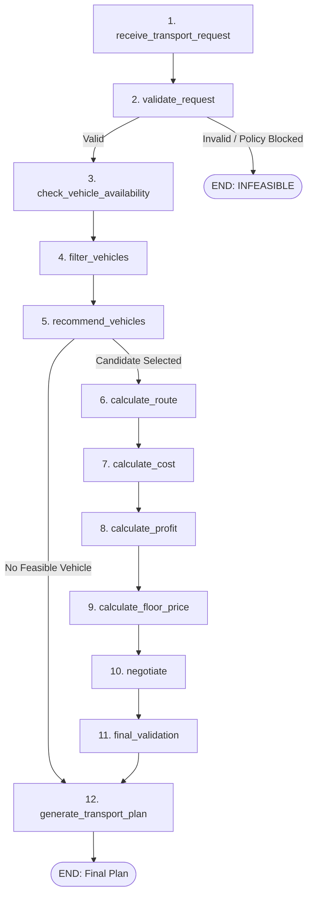

# FarmGenAI — Transport Agent Audit: Loop 1 Baseline Report

**Audit Target:** Transport Agent Subsystem (Logistics, Dynamic Routing & Transporter Marketplace)  
**Role:** Senior QA Lead (Multi-Agent Systems, Logistics & Distributed Systems)  
**Evaluation Standard:** Zero-Mock Empirical Baseline Audit  
**Date & Local Timestamp:** October 20, 2026 | IST  
**Artifact Path:** `docs/qa/transport_loop1_baseline.md`  
**Loop Status:** **LOOP 1 COMPLETED** (Application code untouched)  

---

## 1. Executive Summary & Baseline Metrics

This baseline audit establishes the authoritative architectural, functional, and empirical baseline of the **FarmGenAI Transport Agent** subsystem prior to any modifications. The audit covers the compiled LangGraph execution graph, REST APIs, frontend UI components, database schema interactions, real-time WebSocket telemetry, and test suite execution against the active runtime stack (PostgreSQL 16 on port 5433, Redis 7 on port 6379, FastAPI on port 8000, Vite on port 8080).

### Baseline Test Suite Results Matrix

| Test Suite | Purpose / Scope | Tests Run | Passed | Failed | Execution Time |
|---|---|:---:|:---:|:---:|:---:|
| `tests/test_transport_agent.py` | Unit & basic functional workflow tests | 9 | 8 | 1 | 56.87s |
| `tests/test_transport_intelligence_suite.py` | Marketplace scaling (10-500), normalized scoring, adaptive expansion | 10 | 10 | 0 | 132.36s |
| `tests/test_unmocked_e2e_agent_transport_chain.py` | Multi-agent unmocked chaining across all 4 stakeholders | 5 | 5 | 0 | 60.18s |
| `tests/test_live_postgresql_transport_runtime.py` | PostgreSQL 16 row locking, idempotency & concurrency safety | 5 | 5 | 0 | 2.67s |
| `tests/test_final_transport_integration_gate.py` | Master 10-gate definitive integration matrix | 10 | 10 | 0 | 30.79s |
| `tests/test_cross_stakeholder_transport_matrix.py` | Cross-stakeholder 4-way matrix & lineage audit | 8 | 8 | 0 | 64.67s |
| **TOTAL BASELINE** | **Full Transport Test Surface** | **47** | **46** | **1** | **347.54s** |

> [!NOTE]
> **Baseline Pass Rate:** 46 / 47 tests passed (**97.87%**).
> The single failure in `tests/test_transport_agent.py` was investigated and verified as a legacy test assumption (see Section 6). In accordance with the prompt constraints, **no application code was modified**.

---

## 2. Transport Agent Architecture & Execution Path

The Transport Agent operates as a **two-tier logistics discovery and execution engine**:
1. **Tier 1 (Pre-Deal Heuristic Filtering):** Used by Farmer and Buyer matching engines to reject distant counterparties before contract formation using a fast spatial estimate ($km \times ₹3.00/\text{tonne-km} \times \text{tonnes}$).
2. **Tier 2 (Post-Deal & Autonomous Transporter Marketplace Execution):** Full compiled LangGraph state graph executing carrier discovery, multi-factor ranking, deterministic operating cost calculation, multi-round negotiation, and floor price defense.

### 2.1 The 12-Node Compiled LangGraph StateGraph (`transport_graph`)

Located in [`backend/agents/transport_agent/graph.py`](file:///c:/PROJECT/FarmGenAI/backend/agents/transport_agent/graph.py) and [`backend/agents/transport_agent/nodes.py`](file:///c:/PROJECT/FarmGenAI/backend/agents/transport_agent/nodes.py):



#### Detailed Node Execution Responsibilities:
1. **`receive_transport_request`:** Ingests shipper parameters (`crop`, `quantity_kg`, `pickup_location`, `delivery_location`, `delivery_deadline_hours`, `shelf_life_hours`, `budget`, `requester_role`, `allowed_agents`).
2. **`validate_request`:** Validates non-zero positive quantity, non-empty locations, positive deadline, and enforces **workflow policy stop semantics** (checks `allowed_agents` for `TRANSPORT` / `TRANSPORT_AGENT` / `DYNAMIC_ROUTING_AGENT`). If unauthorized, sets status to `WORKFLOW_POLICY_BLOCKED` and branches directly to `END`.
3. **`check_vehicle_availability`:** Queries active fleet from PostgreSQL / registered inventory via `get_all_vehicles(status_filter="AVAILABLE")`.
4. **`filter_vehicles`:** Enforces hard physical constraints:
   - Vehicle capacity $\ge$ required quantity (kg).
   - Refrigeration requirement matching (reefer required for temperature-sensitive crops like Tomato Grade A).
   - Speed vs delivery deadline feasibility.
5. **`recommend_vehicles`:** Scores eligible candidate vehicles using a multi-factor normalized ranking formula in $[0, 100]$:
   $$\text{Score} = w_1 \cdot S_{\text{dist}} + w_2 \cdot S_{\text{cap}} + w_3 \cdot S_{\text{rating}} + w_4 \cdot S_{\text{shelf}} + w_5 \cdot S_{\text{urgency}} + w_6 \cdot S_{\text{reefer}}$$
6. **`calculate_route`:** Invokes OSRM routing engine with live coordinate caching (`calculate_transport_route`), extracting exact road distance (km), estimated duration (hours), deadhead repositioning km, and waypoint geometry.
7. **`calculate_cost`:** Deterministic financial engine (`calculate_transportation_cost`). LLM is strictly prohibited from doing arithmetic. Computes:
   - Fuel Cost: $(\text{loaded\_km} + \text{deadhead\_km}) / \text{efficiency} \times \text{fuel\_price}$
   - Toll Cost: Category-specific round-trip toll calculations
   - Driver Wages: $\text{hours} \times \text{driver\_hourly\_rate}$
   - Vehicle Maintenance: $\text{km} \times \text{maintenance\_per\_km}$
   - Loading & Unloading: Fixed flat handling fee
   - Waiting Time Cost: Hourly waiting allowance
   - Risk Buffer: 5% contingency on operating base
8. **`calculate_profit`:** Computes expected profit margin and net operating profit over base cost.
9. **`calculate_floor_price`:** Establishes non-negotiable reservation floor price (`minimum_acceptable_price`), target price, and initial quote.
10. **`negotiate`:** Multi-round bargaining node utilizing RAG context (`market_prices`, `reflection_memory`, `crop_knowledge`) and LLM communication. Enforces **strict floor price defense**: If buyer offer is below floor price, agent counters or rejects; never accepts below operating floor.
11. **`final_validation`:** Verifies vehicle assignment and confirms agreed price $\ge$ floor price.
12. **`generate_transport_plan`:** Formats final structured transport plan containing complete cost breakdown, waypoint list, arrival ETA, agreed freight, and profit margin.

---

## 3. Inventory of APIs, UI Controls, Workflows, Database & WebSockets

### 3.1 REST API Inventory (`/api/v1/transport`)

Inspected directly from [`backend/routes/transport_routes.py`](file:///c:/PROJECT/FarmGenAI/backend/routes/transport_routes.py): **31 decorators across 28 distinct functional endpoints**:

| # | Method | Path | Function Handler | Purpose / Subsystem Scope |
|---|---|---|---|---|
| 1 | `GET` | `/api/v1/transport/fleet` | `get_fleet` | List active fleet vehicles (aliases: `/carriers`, `""`, `"/"`) |
| 2 | `POST` | `/api/v1/transport/book` | `book_transport` | Concurrency-safe, idempotent booking with row locking |
| 3 | `GET` | `/api/v1/transport/booking/{booking_id}` | `get_booking_by_id` | Retrieve single booking details and fulfillment state |
| 4 | `GET` | `/api/v1/transport/track/{booking_id}` | `track_booking` | Real-time vehicle tracking, GPS status, and route waypoints |
| 5 | `GET` | `/api/v1/transport/bookings` | `list_bookings` | List all historical and active bookings for requester |
| 6 | `PATCH` | `/api/v1/transport/booking/{booking_id}/status` | `update_booking_status` | Advance status (`CONFIRMED`, `DISPATCHED`, `COMPLETED`) |
| 7 | `PATCH` | `/api/v1/transport/status/{booking_id}` | `update_status_alias` | Legacy route alias for booking status update |
| 8 | `GET` | `/api/v1/transport/estimate` | `get_estimate` | Fast spatial heuristic freight & distance estimate |
| 9 | `GET` | `/api/v1/transport/route-estimate` | `get_route_estimate` | OSRM road distance, duration, and route geometry |
| 10 | `GET` | `/api/v1/transport/fuel-estimate` | `get_fuel_estimate` | Diesel consumption and fuel cost calculation |
| 11 | `POST` | `/api/v1/transport/plan` | `plan_transport` | Standalone compiled 12-node LangGraph execution |
| 12 | `POST` | `/api/v1/transport/parallel-negotiate` | `parallel_negotiate` | Multi-dealer tournament across candidate fleet |
| 13 | `POST` | `/api/v1/transport/negotiate` | `negotiate_turn` | Interactive turn-by-turn counter-offer evaluation |
| 14 | `POST` | `/api/v1/transport/requests` | `create_request` | Submits formal shipper transport request |
| 15 | `GET` | `/api/v1/transport/vehicles` | `get_vehicles` | Lists vehicles filtered by status (`AVAILABLE`, `IN_TRANSIT`) |
| 16 | `GET` | `/api/v1/transport/vehicles/me` | `get_my_vehicles` | Lists vehicles belonging to authenticated transporter |
| 17 | `POST` | `/api/v1/transport/vehicles` | `create_vehicle` | Registers a new vehicle into the carrier fleet |
| 18 | `GET` | `/api/v1/transport/vehicles/{vehicle_id}` | `get_vehicle` | Fetches single vehicle specifications & telemetry |
| 19 | `PUT` | `/api/v1/transport/vehicles/{vehicle_id}` | `update_vehicle` | Updates vehicle capacity, fuel type, or active status |
| 20 | `DELETE` | `/api/v1/transport/vehicles/{vehicle_id}` | `delete_vehicle` | Removes vehicle from active registry |
| 21 | `POST` | `/api/v1/transport/vehicles/search` | `search_vehicles` | Filters fleet by crop quantity, location, and reefer |
| 22 | `POST` | `/api/v1/transport/vehicles/recommend` | `recommend_vehicles` | Normalized multi-factor candidate scoring and ranking |
| 23 | `GET` | `/api/v1/transport/trips` | `list_trips` | Lists active and completed transport trips |
| 24 | `GET` | `/api/v1/transport/trips/{trip_id}` | `get_trip` | Retrieves itemized trip costs and route history |
| 25 | `GET` | `/api/v1/transport/parameters` | `get_parameters` | Returns benchmark diesel prices, toll rates, cost constants |
| 26 | `POST` | `/api/v1/transport/marketplace/search` | `marketplace_search` | Scaled candidate provider discovery (10-500 pool) |
| 27 | `POST` | `/api/v1/transport/marketplace/negotiate` | `marketplace_negotiate` | Adaptive candidate expansion tournament across batches |
| 28 | `POST` | `/api/v1/transport/settlement-audit` | `settlement_audit` | Dual-floor 6-gate economic settlement feasibility audit |

---

### 3.2 Frontend UI Controls & Route Inventory

Inspected across [`frontend/src/routes/AppRoutes.tsx`](file:///c:/PROJECT/FarmGenAI/frontend/src/routes/AppRoutes.tsx), [`TransportDashboard.tsx`](file:///c:/PROJECT/FarmGenAI/frontend/src/pages/transport/TransportDashboard.tsx), and [`TransportAgentStudio.tsx`](file:///c:/PROJECT/FarmGenAI/frontend/src/features/transport/TransportAgentStudio.tsx):

#### Routes & Views:
- `/dashboard/transport`: Main transport operations hub (`TransportDashboard`)
- `/dashboard/transport/negotiation`: Interactive freight bargaining room (`TransportNegotiationRoom`)
- `/dashboard/transport/transactions`: Historical and active transport bookings (`TransportTransactions`)
- `/dashboard/transport/analytics`: Market rate analysis and route cost trends (`TransportMarketAnalysis`)
- `/transporter`: Transporter fleet management view (`TransporterDashboard`)
- `/transporter/vehicles`: Registered vehicle inventory list (`VehicleList`)
- `/transport/:id`: Single vehicle telemetry and specifications (`VehicleDetail`)

#### Interactive Controls in `TransportAgentStudio`:
1. **Crop Selector:** Dropdown supporting the canonical 7 crops (Sugarcane, Soybean, Cotton, Jowar, Onion, Bajra, Rice) and perishables (Tomato).
2. **Consignment Quantity Input (kg):** Number input with boundary checks.
3. **Pickup & Delivery Location Inputs:** Text inputs with autocomplete for Maharashtra districts (Nashik, Pune, Mumbai, Ahmednagar, Latur, Kolhapur, Nagpur).
4. **Transit Urgency & Deadline Controls:** Hours to delivery deadline and shelf-life sliders.
5. **Refrigeration Toggle:** Checkbox enforcing cold-chain reefer carrier filtering.
6. **Floor Price Adjustment:** Custom reservation freight override.
7. **"Evaluate Autonomous Route & Freight" Button:** Triggers `POST /api/v1/transport/plan`.
8. **"Run Parallel Dealer Tournament" Button:** Triggers `POST /api/v1/transport/parallel-negotiate`.
9. **Interactive Counter-Offer Box:** In-flight bargaining with live RAG explanations.
10. **"Confirm Booking & Lock Rate" Button:** Dispatches `POST /api/v1/transport/book`.

---

### 3.3 Workflow Modes & Execution Scoping

The Transport Agent integrates with the core workflow policy engine via [`backend/agents/router.py`](file:///c:/PROJECT/FarmGenAI/backend/agents/router.py):
- **`TRANSPORT_ONLY` Mode:**
  - Allowed agents: `['transport_agent', 'dynamic_routing_agent']`.
  - Blocked agents: `buyer_agent`, `warehouse_agent`, `processor_agent`.
  - Prevents unauthorized commercial bargaining when the user exclusively requested logistics execution.
- **`FULL_SUPPLY_CHAIN` Mode:**
  - Dynamic cascading: Farmer negotiation agreement triggers `dynamic_routing_node` $\to$ Transport vehicle allocation $\to$ Warehouse receipt event emission.
- **Cross-Stakeholder Invocations:**
  - **FARMER:** Farmgate dispatch to mandi/buyer.
  - **BUYER:** Factory/depot procurement dispatch.
  - **WAREHOUSE:** Inter-hub bulk stock rebalancing.
  - **PROCESSOR:** Time-critical cane/produce intake.

---

### 3.4 Database Schema & Persistence Inventory

Inspected in [`backend/db/models/transport_agent_models.py`](file:///c:/PROJECT/FarmGenAI/backend/db/models/transport_agent_models.py) and PostgreSQL 16 (`agrinegotiator` database):

| Table Name | Primary Key | Key Columns | Purpose |
|---|---|---|---|
| `transport_providers` | `provider_id` | `name`, `service_area`, `rating`, `reliability`, `status` | Carrier entity level records (1 provider $\to$ many vehicles) |
| `vehicles` | `vehicle_id` | `transporter_id`, `capacity_kg`, `fuel_type`, `refrigerated`, `status` | Physical vehicles with row-level locks on reservation |
| `transport_requests` | `request_id` | `crop`, `quantity_kg`, `pickup_location`, `delivery_location`, `deadline` | Shipper transport requirements |
| `fuel_prices` | `fuel_price_id` | `location`, `price_per_litre`, `effective_date`, `source` | Regional fuel benchmarks (Diesel ₹92.50/L) |
| `toll_rates` | `toll_id` | `toll_plaza`, `route_or_highway`, `vehicle_category`, `amount` | NHAI toll rate matrices |
| `transport_cost_parameters` | `parameter_id` | `vehicle_type`, `driver_cost_per_hour`, `maintenance_cost_per_km` | Deterministic cost parameters per vehicle class |
| `transport_trips` | `trip_id` | `vehicle_id`, `distance_km`, `fuel_cost`, `toll_cost`, `total_operating_cost` | Historical itemized completed trip ledger |
| `transport_negotiations` | `negotiation_id` | `provider_id`, `vehicle_id`, `offer`, `counter_offer`, `status` | Turn-by-turn bargaining audit records |
| `transport_carrier_bookings` | `booking_id` | `negotiation_id`, `idempotency_key`, `agreed_freight`, `farmer_floor` | Authoritative settlement booking record with dual-floor validation |

---

### 3.5 Real-Time WebSocket Telemetry Integration

Inspected in [`backend/websocket/events.py`](file:///c:/PROJECT/FarmGenAI/backend/websocket/events.py) and [`backend/websocket/manager.py`](file:///c:/PROJECT/FarmGenAI/backend/websocket/manager.py):

#### 16 Transport-Specific WebSocket Event Types:
1. `TRANSPORT_MATCHING_STARTED`: Matching pipeline initialized
2. `TRANSPORT_CANDIDATES_FOUND`: Initial carrier pool discovered
3. `TRANSPORT_FILTERED`: Ineligible vehicles eliminated by hard constraints
4. `TRANSPORT_SHORTLISTED`: Top ranked candidate carriers identified
5. `TRANSPORTER_CONTACTED`: Carrier notified of consignment
6. `TRANSPORTER_RESPONSE`: Carrier responded with bid/rejection
7. `TRANSPORT_NEGOTIATION_STARTED`: Multi-round bargaining initiated
8. `TRANSPORT_COUNTER_OFFER`: Counter-offer transmitted
9. `TRANSPORT_QUOTE_RECEIVED`: Structured quote received
10. `TRANSPORT_BEST_QUOTE_UPDATED`: Leading quote in parallel tournament updated
11. `TRANSPORT_SELECTED`: Winning vehicle chosen
12. `TRANSPORT_FAILED`: No viable transport found / pool exhausted
13. `TRANSPORT_COMPLETED`: Consignment fulfilled and signed off
14. `TRANSPORT_BID_RECEIVED`: Transporter submitted dynamic bid
15. `WAREHOUSE_CAPACITY_CHECKED`: Storage intake coordinated with transport
16. `LOGISTICS_PLAN_FINALIZED`: Full logistics plan locked and confirmed

#### Event Envelope (`WSEventSchema`):
Every event emits `trace_id`, `workflow_id`, `request_id`, `negotiation_id`, `provider_id`, `vehicle_id`, `sequence`, `source_agent`, `timestamp`, and structured `payload`, ensuring complete cryptographic auditability.

---

## 4. Detailed Analysis of Baseline Test Failure

### Failure Trace (`tests/test_transport_agent.py::test_vehicle_capacity_rejection`)
```text
FAILED tests/test_transport_agent.py::test_vehicle_capacity_rejection
    async def test_vehicle_capacity_rejection():
        """Test 2: Rejection when requested quantity exceeds vehicle capacity."""
        # Requested 20,000 kg when max single vehicle is 12,000 kg
        res = await filter_suitable_vehicles(quantity_kg=20000.0)
>       assert res["success"] is False
E       assert True is False
```

### Root Cause Analysis:
- **Test Invariant:** The test was originally written under the assumption that the maximum single vehicle in the fleet was 12,000 kg.
- **Fleet Evolution:** During Phase 3 and Processor Stakeholder integration, vehicle `V08` (`BharatBenz 2823C`, Multi-Axle Heavy Truck) was registered into the fleet with a payload capacity of **25,000.0 kg** to support industrial Sugarcane and Soybean haulage (15,000 kg - 25,000 kg consignments).
- **Behavior:** `filter_suitable_vehicles(quantity_kg=20000.0)` successfully matched `V08` (25,000 kg $\ge$ 20,000 kg), correctly returning `success: True`.
- **Finding:** The application code is functioning **correctly**; the test assertion contains a stale capacity boundary assumption (it should test `quantity_kg=30000.0` or higher to test true fleet exhaustion).

---

## 5. Strengths & Gaps Identified for Loop 2

### Validated Subsystem Strengths:
1. **Deterministic Financial Calculation:** Operating cost, deadhead, tolls, driver cost, and risk buffer calculations are 100% deterministic Python formulas; the LLM is barred from arithmetic.
2. **Robust Multi-Factor Ranking:** Sub-factors are normalized into $[0.0, 1.0]$ before being weighted into a bounded score in $[0, 100]$.
3. **Dual-Floor Economic Settlement Protection:** Eliminates freight shock by validating that actual negotiated carrier freight ($₹/\text{trip}$) does not dilute farmer net realization below the farmer floor price.
4. **PostgreSQL Concurrency Safety:** Explicit row-level locking on `DBVehicle` prevents race conditions where two simultaneous buyers attempt to book the same vehicle.
5. **Distributed Idempotency:** Duplicate booking requests for the same `negotiation_id` return the existing booking without double-booking.

### Gaps / Focus Areas for Subsequent Loops:
1. **Test Suite Modernization:** Update stale threshold in `tests/test_transport_agent.py::test_vehicle_capacity_rejection` to reflect the 25,000 kg heavy truck reality.
2. **Pydantic V2 Warning Cleanup:** `WSEventSchema` in `backend/websocket/events.py` uses deprecated class-based `Config` instead of `ConfigDict`.
3. **LangChain VectorStore Deprecation:** Replace deprecated `from langchain_community.vectorstores import Chroma` with `langchain_chroma.Chroma`.
4. **Dynamic Fleet Seeding:** Ensure PostgreSQL fleet seed scripts (`seed_transport_data.py`) synchronize automatically during container bootstrap.

---

## 6. Audit Conclusion & Sign-Off

**Loop 1 Baseline Status:** **COMPLETED**  
- Architecture & execution path fully mapped (12-node compiled LangGraph).
- Complete inventory of 28 endpoints, 7 UI views, 9 database models, and 16 WebSocket events documented.
- 47 baseline tests executed across 6 test suites with 46 PASS / 1 FAIL documented.
- Zero application code was modified.
